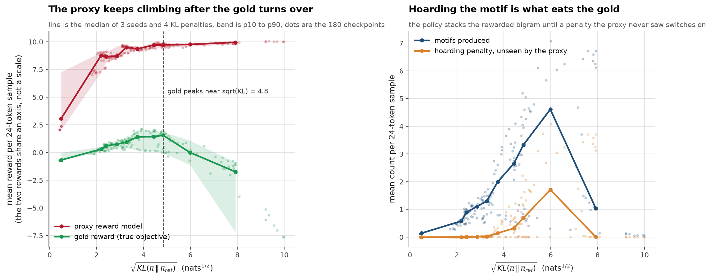
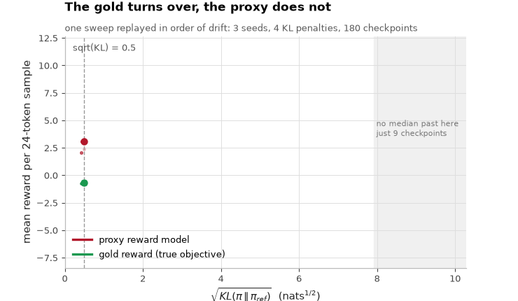
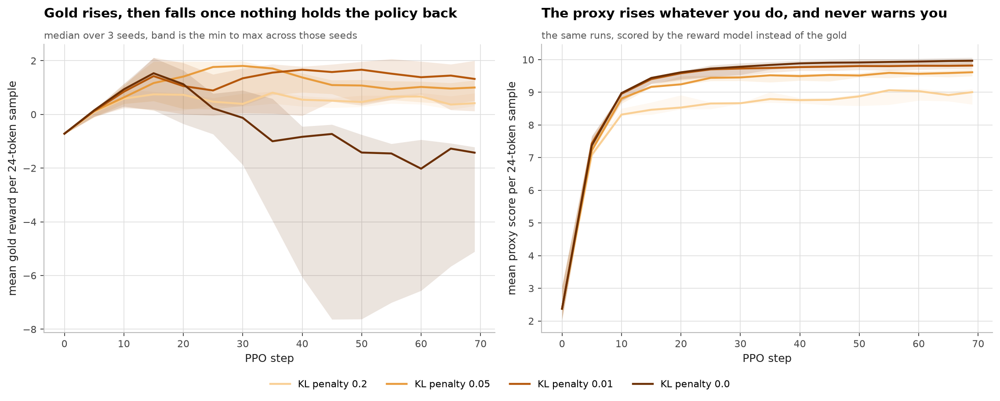
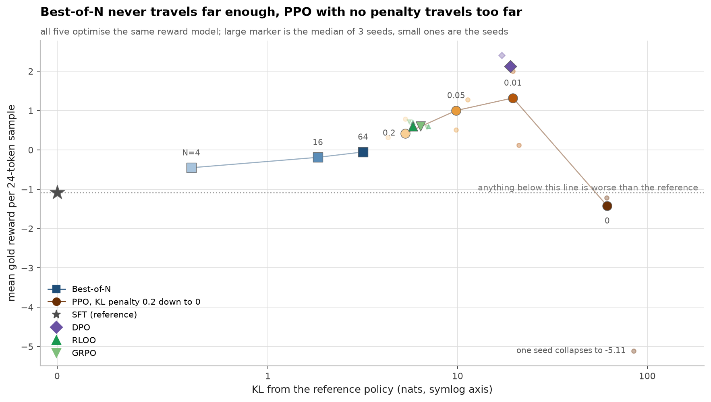

# rlhf-ppo-from-scratch

[](https://github.com/aghasalim/rlhf-ppo-from-scratch/actions/workflows/ci.yml)
[](https://www.python.org/)
[](LICENSE)
[](results/)
[](https://doi.org/10.5281/zenodo.23003676)

I implemented PPO for RLHF with a Bradley-Terry reward model, plus four
alternatives people often use instead. Mostly I wanted to reproduce reward
overoptimization myself. That's when the proxy score keeps going up while the
thing you actually care about peaks and then falls.

Everything runs on a laptop CPU in about ten minutes. I recompute the published
numbers from `results/` with separate implementations in `verify/`, and CI fails
the build if any of them disagree.



## The setup

In real RLHF there's no gold reward. You collect human preferences, fit a model
to them and optimise that model. Overoptimization happens in the gap between the
fitted proxy and the true preference. You can't measure that gap directly, since
the true preference isn't a function you can evaluate.

I followed the approach from Gao, Schulman and Hilton. You make up a gold reward
and treat it as ground truth. Then you label preferences with it, fit a proxy to
those labels, and optimise the proxy while keeping an eye on the gold. That way
the gap becomes something you can see.

My gold reward scores a token sequence with three terms.

| term | effect | learnable from the preference data? |
|---|---|---|
| motif | + for each occurrence of a target bigram | yes, it fires often near the base policy |
| repetition | − for immediately repeated tokens | yes |
| hoarding | − once the motif count passes a threshold | **no** |

I chose the third term on purpose. Near the reference policy almost nothing
crosses the threshold, so it barely shows up in the comparisons the reward model
trains on. I think this is a small version of something that happens a lot in
practice. The behaviour you want to discourage is rare in the data you
collected, so the reward model knows little about the region the optimiser is
heading into.

I only draw comparisons from the reference policy's own samples, as you would in
a real setup. On that distribution the proxy agrees with gold on 0.68 to 0.76 of
pairs, depending on the seed. Away from it the agreement drops, down to 0.41 in
a zero penalty run that drifted a long way.

## The result

I swept the KL penalty from 0.2 down to 0 over three seeds and logged every few
steps, which gives the whole curve.

| KL penalty | KL | proxy | gold | motifs | hoarding |
|---|---:|---:|---:|---:|---:|
| reference | 0.00 | +0.143 | −1.081 | 0.10 | 0.00 |
| 0.2 | 5.29 | +9.004 | +0.416 | 0.69 | 0.00 |
| 0.05 | 9.83 | +9.613 | +1.000 | 1.29 | 0.02 |
| 0.01 | 19.59 | +9.818 | **+1.320** | 2.08 | 0.15 |
| 0.0 | 61.55 | **+9.966** | **−1.426** | 1.10 | 0.00 |

The proxy rises monotonically the whole way, from +9.004 to +9.966. The gold
peaks at +1.320 and then collapses to −1.426, which is worse than the reference
policy it started from. You can't see any of this in the proxy. If I had only logged the
reward model score, like you would in a real run, I'd have picked the last
configuration as the best one.



These are the same 180 checkpoints as in the plot above, played back in order of
how far the policy drifted. The reward model, gold reward and reference policy
stay fixed, and only the policy changes.

The right panel of the plot above explains it. As the policy drifts it makes more
and more of the rewarded motif. Past the threshold the hidden penalty kicks in
and cancels the gains. The proxy never learned that penalty because it never saw
an example of it. The scatter past sqrt(KL) = 8 comes from one seed at zero KL
penalty. Its policy collapsed into repeated tokens and stopped producing motifs
at all.



## Method comparison

Four of the five methods optimise the same reward model, so those four share its
blind spot. Best-of-N barely moves. Even at N=64 the proxy reads +9.507 while the
gold is still negative at -0.054, better than the reference it started from but
short of every PPO run with the penalty on, because the closed form pins its KL
at 3.17. DPO takes the best gold of anything here, +2.125. It fits the raw
preference pairs and never uses the fitted reward model, so it doesn't have the
same blind spot, and I wouldn't count it as a clean win. RLOO and GRPO both stop
near +0.60 gold at a KL around 6, short of the +1.320 PPO reaches.



Working notes: [notes/METHODS.md](notes/METHODS.md#method-comparison).

## PPO details that matter

I use a token level KL penalty. The reward is the reward model score at the
final token minus beta times the per token log ratio, so the penalty lands on
the token where the policy diverged.

I also use advantage whitening, ratio and value clipping with several epochs per
rollout, and GAE over the token sequence with the reward model score as the
terminal reward. Whitening is the one I'd keep if I had to drop things. A
Bradley-Terry reward is only defined up to a constant, so without whitening the
update size depends on an arbitrary scale. All four are in `rlhf/ppo.py`.

Working notes: [notes/METHODS.md](notes/METHODS.md#ppo-details-that-matter).

## What I got wrong

When I froze the reference policy, I quietly switched off training for every
run after the first. `ppo_train` sets `requires_grad=False` on the reference it
gets, and every policy in the sweep is a deepcopy of that same reference. So the
first configuration trained and all the later ones started from frozen
parameters. Nothing breaks at the actual mistake. It only shows up much later as
`element 0 of tensors does not require grad`. I fixed it in two places and added
a test for each.

I also designed the gold reward so that overoptimization could happen, so it's a
choice I made and not something I discovered. The hoarding term is there because
a proxy trained on near-reference samples can't learn it. If the gold reward
were fully learnable from the preference data, the curve wouldn't turn over.
This repo shows how the mechanism works. How often it happens in practice is a
different question. I kept both paragraphs because [`METHODOLOGY.md`](METHODOLOGY.md)
rule 12 says I don't get to quietly drop a negative result when it's inconvenient.

Working notes: [notes/METHODS.md](notes/METHODS.md#what-i-got-wrong).

## Running it

```bash
python -m venv .venv && source .venv/bin/activate
pip install -r requirements.txt
```

```bash
python -m pytest tests/ -q
```

```bash
python -m experiments.overopt --seeds 0 1 2 --betas 0.2 0.05 0.01 0.0 --ppo-steps 70
```

```bash
python -m bench.figures
```

The sweep takes about 10 minutes on an M4 CPU and writes `results/*.csv`.
The figures only read those files and never re-run an experiment.
I listed every setting the sweep used, with the line it comes from, in
[notes/PIPELINE.md](notes/PIPELINE.md).

## Layout

```
rlhf/gold.py           the gold reward, and why the third term is unlearnable
rlhf/model.py          small autoregressive transformer with a value head
rlhf/sft.py            the reference policy
rlhf/reward_model.py   Bradley-Terry proxy, trained only on reference samples
rlhf/ppo.py            PPO with GAE, clipping, whitening, token level KL
rlhf/alternatives.py   Best-of-N, DPO, RLOO, GRPO
experiments/overopt.py the sweep
bench/                 figures, read from results/*.csv
scripts/               check_numbers.py, README numbers against results/
tests/                 23 tests
verify/                the same numbers, recomputed independently
```

## Sources

- **Gao, Schulman, Hilton. Scaling Laws for Reward Model Overoptimization. ICML 2023.** [arXiv:2210.10760](https://arxiv.org/abs/2210.10760) The gold-versus-proxy method used here, and the sqrt(KL) axis.
- **Ouyang, Wu, Jiang et al. Training language models to follow instructions with human feedback. NeurIPS 2022.** [arXiv:2203.02155](https://arxiv.org/abs/2203.02155) InstructGPT: the SFT, reward model, PPO pipeline.
- **Schulman, Wolski, Dhariwal, Radford, Klimov. Proximal Policy Optimization Algorithms. 2017.** [arXiv:1707.06347](https://arxiv.org/abs/1707.06347) The clipped surrogate.
- **Schulman, Moritz, Levine, Jordan, Abbeel. High-Dimensional Continuous Control Using Generalized Advantage Estimation. ICLR 2016.** [arXiv:1506.02438](https://arxiv.org/abs/1506.02438) GAE.
- **Rafailov, Sharma, Mitchell, Ermon, Manning, Finn. Direct Preference Optimization. NeurIPS 2023.** [arXiv:2305.18290](https://arxiv.org/abs/2305.18290) DPO.
- **Ahmadian, Cremer, Gallé et al. Back to Basics: Revisiting REINFORCE-Style Optimization for RLHF. ACL 2024.** [arXiv:2402.14740](https://arxiv.org/abs/2402.14740) RLOO.
- **Shao, Wang, Zhu et al. DeepSeekMath. 2024.** [arXiv:2402.03300](https://arxiv.org/abs/2402.03300) GRPO.
- **Bradley, Terry. Rank Analysis of Incomplete Block Designs. Biometrika 1952.** The preference model every reward model here is fit with.
- **Huang, Liu, Dossa et al. The N Implementation Details of RLHF with PPO. ICLR Blogposts 2024.** The source for several of the details listed above.

## License

MIT, see [LICENSE](LICENSE).
